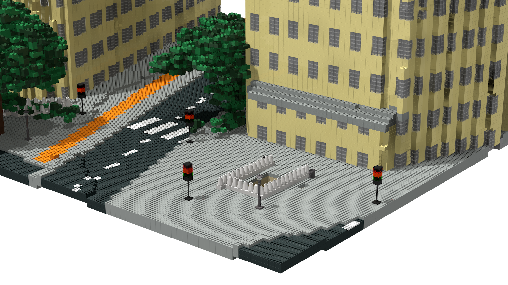

# Voxatile LDraw Module

[LDraw](https://www.ldraw.org/) format (LEGO®) module for [Voxatile](https://github.com/ignfab/voxatile).

## Module overview

This module provides the `ldraw` output format. See [LDraw format documentation](docs/OutputFormat.md) for complete syntax.



## Installation

Compile the module JAR using Maven:
```shell
mvn clean package
```
_Note: You may need to add GitHub authentication to your `~/.m2/settings.xml` file, see [these instructions from GitHub](https://docs.github.com/en/packages/working-with-a-github-packages-registry/working-with-the-apache-maven-registry#authenticating-with-a-personal-access-token)._

Then copy the resulting JAR file `target/voxatile-ldraw-module-1.0-SNAPSHOT.jar` into the modules directory of your Voxatile installation. See [Voxatile modules documentation](https://github.com/ignfab/voxatile/blob/main/docs/usage/Voxatile.md#modules) for more info about how to use modules.

## License

This project is licensed under the terms of the [GNU AGPL v3](LICENSE.txt) license.
